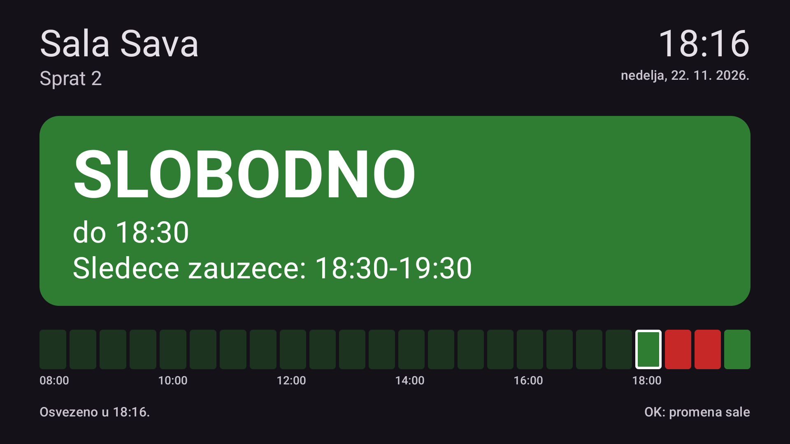
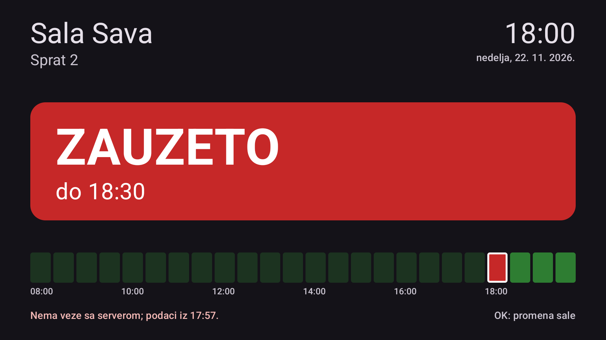

# Faza 5: drugi klijent, ekran pored sale na Android TV-u

Faza 5 dodaje drugi klijent: ekran sa informacijama o zauzetosti sale, za STB uređaj sa
Android TV-om. Ekran samo prikazuje (da li je sala slobodna, do kada, šta je sledeće i
današnji raspored); rezervisanje ostaje na telefonu. Ovaj izveštaj odgovara na pitanje
koliko je drugi klijent koštao i šta je od postojećeg koda mogao da preuzme, a beleži i
proveru rada na telefonu i na TV emulatoru.

Stanje: commit `d94acd5` (korak 5c). Datum: 22. novembar 2026.

---

## 1. Sažetak

**Drugi klijent je dodat bez ijedne izmene servera.** Između oznake `faza-4` i kraja
koraka 5c u `:server` nije promenjena nijedna linija. TV ekran koristi dve javne rute
koje su postojale od faze 1: listu resursa i dnevnu mrežu slotova.

**Šta je trebalo napisati:**

| Gde | Šta | Linija koda |
|---|---|---|
| `:core` | `RoomStatus`: status sale iz dnevne mreže i trenutnog vremena | 31, i 8 testova |
| `:app:shared` | HTTP klijent, `PublicApi` (javne rute), `TimeFormat` premešten sa telefona | 81 |
| `:app:tvApp` | Izbor sale, ekran sale, pamćenje izbora | 452 |
| `:server` | | 0 |

Telefon je pri tome smanjen sa 2 167 na 2 120 linija, jer su podešavanja HTTP klijenta i
formatiranje vremena prešli u deljeni modul i sada ih koriste oba klijenta.

**Udeo deljenog koda:** od koda koji izvršava TV aplikacija, 37,6 % je iz deljenih
modula; za telefon 12,1 %, za server 23,0 % (poglavlje 3).

**Provera:** na telefonu i na Android TV emulatoru ekran pokazuje novu rezervaciju i
otkazivanje u roku jednog osvežavanja (30 s), prelazi sa „SLOBODNO" na „ZAUZETO" tačno na
granici termina i kad server ne radi, i drži ekran upaljenim (poglavlje 4).

**Za hipotezu rada:** drugi klijent, na drugoj vrsti uređaja, napisan je istim jezikom,
istim UI alatom (Jetpack Compose) i po istoj arhitekturi (ViewModel + StateFlow) kao
telefon, nad istim modelom i pravilima, bez promene servera. Ono što nije deljeno su
ekrani, i to namerno (poglavlje 3.3).

---

## 2. Koraci

| Korak | Commit | Sadržaj |
|---|---|---|
| 5a | `b974baa` | `RoomStatus` u `:core`: van radnog vremena, slobodna (do kada, sledeće zauzeće) ili zauzeta (do kraja bloka); uzastopni zauzeti slotovi su jedan blok i kad pripadaju različitim rezervacijama |
| 5b | `c34d20a` | `:app:shared` postaje deljeni klijentski modul: `hotdeskHttpClient()` (engine preko `expect`/`actual`, OkHttp na Androidu) i `PublicApi`; uklonjen primer KMP čarobnjaka; `ApiClient` na telefonu koristi deljeni sloj |
| 5c | `d94acd5` | `:app:tvApp`: TV pokretač i baner, izbor sale daljinskim, ekran sale; `TimeFormat` premešten u `:app:shared` |

`RoomStatus` je u `:core`, a ne u klijentskom modulu, jer je čista logika nad DTO
klasama: ne zavisi od mreže ni od Android-a, testira se u `commonTest` na svakom targetu,
a server bi mogao da ga koristi bez ikakve izmene.

---

## 3. Deljeni kod

### 3.1 Ko koristi šta

| Deljeni fajl | Modul | Linija koda | Server | Telefon | TV |
|---|---|---|---|---|---|
| `Dtos.kt` | `:core` | 72 | da | da | da |
| `Enums.kt` | `:core` | 8 | da | da | da |
| `BookingRules.kt` | `:core` | 80 | da | da | da |
| `ResourceRules.kt` | `:core` | 50 | da | da | ne |
| `RoomStatus.kt` | `:core` | 31 | ne | ne | da |
| `HotdeskHttp.kt` (+ `.android.kt`) | `:app:shared` | 27 | ne | da | da |
| `PublicApi.kt` | `:app:shared` | 26 | ne | da | da |
| `TimeFormat.kt` | `:app:shared` | 28 | ne | da | da |
| `GreetingUtil.kt` | `:core` | 3 | ne | ne | ne |

`GreetingUtil.kt` je ostatak KMP čarobnjaka iz faze 1 (`sayHello`) i niko ga ne koristi.

Iz `BookingRules` TV koristi samo radno vreme, za poruku „van radnog vremena", i vremensku
zonu, preko `TimeFormat`. Granice termina `RoomStatus` čita iz slotova koje šalje server.
Pošto `TimeFormat` uzima zonu `Europe/Belgrade` iz `BookingRules`, oba klijenta prikazuju
isto vreme na isti način, nezavisno od zone uređaja.

### 3.2 Linije koda po modulu i udeo po klijentu

Broje se samo Kotlin fajlovi (`.kt`), bez praznih redova i komentara. Deljeni fajl se
klijentu računa ceo, ako klijent koristi bar jednu njegovu deklaraciju (metod u
poglavlju 6).

| Modul | Fajlova | Linija | Linija koda |
|---|---|---|---|
| `:core` | 6 | 414 | 244 |
| `:core`, testovi | 3 | 315 | 227 |
| `:app:shared` | 4 | 132 | 81 |
| `:server` | 10 | 1 004 | 702 |
| `:server`, testovi | 5 | 779 | 537 |
| `:app:androidApp` (telefon) | 19 | 2 707 | 2 120 |
| `:app:tvApp` (TV) | 7 | 590 | 452 |

| Klijent | Sopstveni kod | Deljeni kod koji koristi | Udeo deljenog |
|---|---|---|---|
| Server | 702 | 210 | 23,0 % |
| Telefon | 2 120 | 291 | 12,1 % |
| TV | 452 | 272 | 37,6 % |

TV ima najveći udeo jer je mali i samo prikazuje: nema prijave, forme ni administracije.
Od njegovih 452 linije, 298 (66 %) su dva ekrana, 81 su ViewModel-i, a 73 aktivnost,
pamćenje izabrane sale i adresa servera. Telefon ima mali udeo iz istog razloga: od
njegovih 2 120 linija većina su ekrani (19 fajlova), koji se ne dele.

### 3.3 Šta nije deljeno, i zašto

- **Ekrani.** TV i telefon koriste isti UI alat, ali ne i iste ekrane. Na televizoru nema
  dodira: fokus se pomera strelicama daljinskog, element u fokusu mora biti jasno
  istaknut, slova su veća, a ivice slike se drže praznim (margine od 5 %), jer ih
  televizori često seku. Zajednički ekran bi morao da sadrži obe verzije.
- **ViewModel-i.** Prate ekrane. TV osvežava mrežu na 30 s i status računa svake sekunde iz
  sata uređaja, a telefon učitava na zahtev korisnika.
- **Rute koje traže prijavu** ostaju u `ApiClient`-u telefona, jer zavise od njegove
  sesije. TV ih ne koristi.

---

## 4. Provera rada

Server je radio na laptopu nad H2, a klijenti su mu pristupali preko lokalne mreže
(`192.168.1.5`).

| Uređaj | |
|---|---|
| Telefon | Pixel 8, Android 17, položen na bok, umesto televizora; daljinski je zamenjen D-pad tasterima preko `adb` |
| TV emulator | Android TV, Android 16 (API 36), 1920×1080, gustina 320 (960×540 dp, kao 1080p televizor), ubrzanje WHPX |

Vremena su očitana čitanjem teksta sa ekrana preko `uiautomator`-a, na svake 2 do 3 s.
Ekran osvežava mrežu na 30 s, pa je očekivano kašnjenje do 30 s, plus vreme očitavanja.

| Provera | Uređaj | Rezultat |
|---|---|---|
| Nova rezervacija (17:30–18:30) | telefon | na ekranu posle 20 s, kao „SLOBODNO do 17:30" i „Sledeće zauzeće: 17:30-18:30"; dva slota kao jedan blok |
| Nova rezervacija (18:00–18:30) | emulator | na ekranu posle 33 s |
| Zauzeta sala | oba | „ZAUZETO do 18:30", tekući slot crven i uokviren |
| Otkazivanje | telefon, emulator | „SLOBODNO" posle 12 s, odnosno 26 s |
| Server zaustavljen | telefon, emulator | ostaju poslednji podaci, uz oznaku „Nema veze sa serverom; podaci iz …"; na emulatoru posle 28 s, na telefonu u roku jednog osvežavanja |
| Server ponovo pokrenut | telefon, emulator | oznaka nestaje sama, posle 15 s, odnosno 31 s |
| Granica termina | emulator | server zaustavljen u 17:58:08; ekran u 18:00:03 prelazi na „ZAUZETO do 18:30", iz podataka iz 17:57 |
| Ekran se ne gasi | emulator | sistem drži `SCREEN_BRIGHT_WAKE_LOCK` u ime `rs.ftn.hotdesk.tv` dok je ekran sale otvoren |
| Pamćenje sale | telefon | posle zaustavljanja i ponovnog pokretanja aplikacija odmah prikazuje izabranu salu |
| Promena sale | oba | OK otvara izbor sale sa fokusom na trenutnoj; Nazad vraća bez promene |
| TV pokretač | emulator | aplikacija je u „Installed Apps" sa banerom; na izabranoj pločici piše naziv; OK je pokreće |
| Raspored | oba | na 1080p status je u punoj veličini; na telefonu (oko 400 dp visine) status se smanjuje, a ceo raspored staje |

Prelaz na granici termina je najvažniji rezultat ove tabele: server tada nije radio, pa je
prelaz mogao da pokrene samo sat uređaja. Ekran zato ostaje tačan i kad mreža ne radi,
sve dok ima današnju mrežu slotova.

| Slobodno, sa sledećim zauzećem | Zauzeto, posle granice i bez veze sa serverom |
|---|---|
|  |  |

Oba snimka su sa emulatora, u punoj rezoluciji 1920×1080. Desni je snimljen u 18:00, dva
minuta posle zaustavljanja servera.

Na telefonu ovaj prelaz nije posmatran: u 17:30 aplikacija je bila u pozadini, jer je
telefon u međuvremenu korišćen. Zato je provera ponovljena na emulatoru, gde nikoga ne
ometa.

Tokom provere nađena je i ispravljena jedna greška rasporeda, pre commit-a 5c. Na
telefonu se donji red nije video, jer sadržaj nije poštovao sistemske trake, a veličina
statusa je bila fiksna. Status sada dobija veličinu prema prostoru koji preostane.

---

## 5. Opterećenje servera

Ovo je model, kao u [fazi 3](../faza-3/README.md#7-da-li-je-to-dovoljno-zahtevi-iz-domena),
a ne novo merenje: server nije menjan, a ruta koju ekran koristi izmerena je u fazama 3 i 4.

Svaki ekran šalje jedan zahtev na 30 s. Za firmu od 1 000 zaposlenih uzeto je 20 sala
sa ekranom, što je pretpostavka. To je **0,67 zahteva u sekundi**, ravnomerno tokom celog
dana.

| | Zahteva/s |
|---|---|
| 20 ekrana | 0,67 |
| Korisnici u vršnih 15 minuta (model faze 3) | ~7 |
| Kapacitet rute `availability`, H2 | ~2 800–3 350 |
| Kapacitet rute `availability`, PostgreSQL bez pool-a veza | ~90 |

Ekrani dodaju manje od 10 % vršnog opterećenja od korisnika i daleko su ispod kapaciteta,
i nad PostgreSQL-om bez pool-a veza. Osvežavanje na 30 s određuje samo koliko brzo se nova
rezervacija pojavi na ekranu; prelaz na granici termina ne zavisi od njega.

---

## 6. Ograničenja

- **Linija koda je gruba mera.** Ne meri složenost ni uloženi rad, a Compose ekrani su po
  prirodi opširni.
- **Deljeni fajl se računa ceo.** TV iz `BookingRules.kt` koristi samo radno vreme i
  vremensku zonu, a računa mu se svih 80 linija; isto važi za `Dtos.kt`. Udeo deljenog koda
  je zato gornja granica, ne tačna mera.
- **Korišćenje se prepoznaje po imenu.** Deklaracija se smatra korišćenom ako se njeno ime
  pojavljuje kao reč u kodu klijenta. Skripta ne proverava da li je to zaista ista
  deklaracija; za ovaj projekat je rezultat (poglavlje 3.1) proveren ručno.
- **Provera je urađena na emulatoru i telefonu, ne na pravom STB uređaju.** Brzina
  iscrtavanja i potrošnja memorije na slabijem STB procesoru nisu merene.
- **TV aplikacija nema automatske testove.** Njena logika, `RoomStatus`, ima 8 testova u
  `:core`; ekrani su provereni ručno.
- **Adresa servera je upisana u `TvActivity`** (i u `network_security_config.xml`), kao i
  na telefonu.
- **Nema automatskog pokretanja.** Posle uključivanja uređaja aplikacija se otvara iz
  TV pokretača; da bi se sama otvorila, uređaj bi trebalo podesiti kao kiosk.

---

## 7. Kako ponoviti

Brojanje linija, iz korena projekta:

```bash
powershell -ExecutionPolicy Bypass -File docs\merenja\faza-5\skripte\linije.ps1
```

Skripta ispisuje tabele iz poglavlja 3 i upisuje [`moduli.csv`](moduli.csv) i
[`klijenti.csv`](klijenti.csv). Promena servera tokom faze:

```bash
git diff --stat faza-4..d94acd5 -- server
```

Ispis je prazan.

TV aplikacija se pokreće na Android TV emulatoru (Android Studio, Device Manager:
uređaj „Television (1080p)", slika „Android TV") ili na STB uređaju:

```bash
.\gradlew.bat :app:tvApp:installDebug
```
